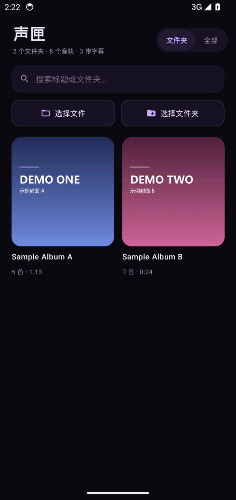
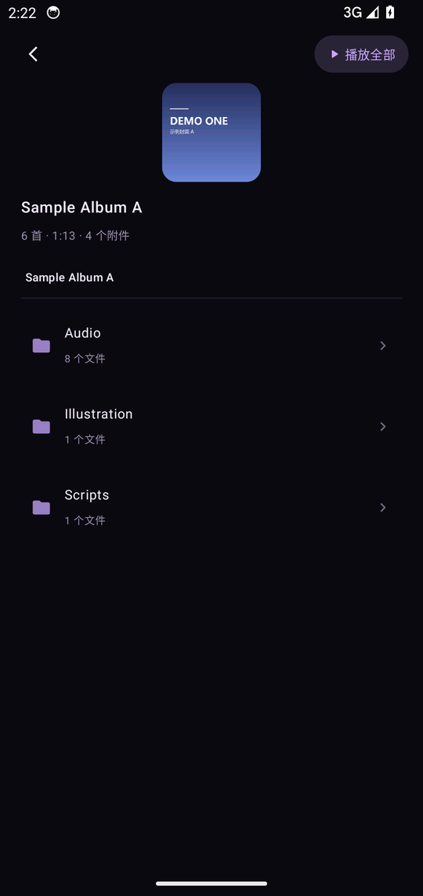
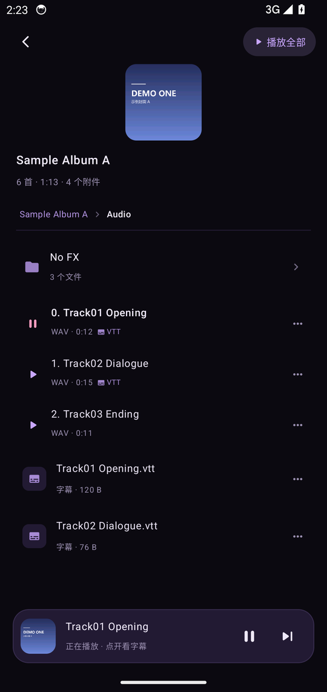
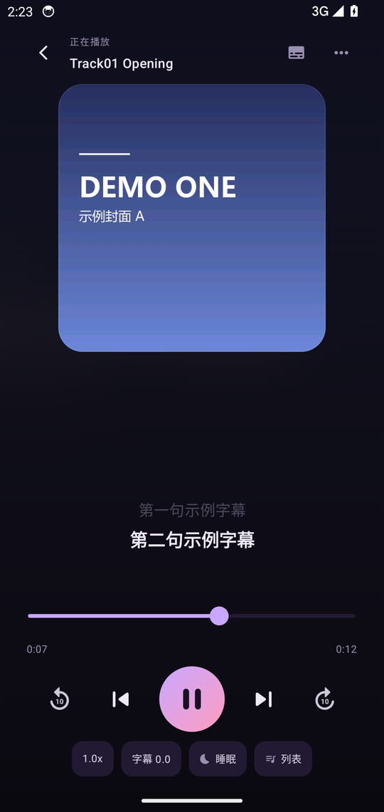
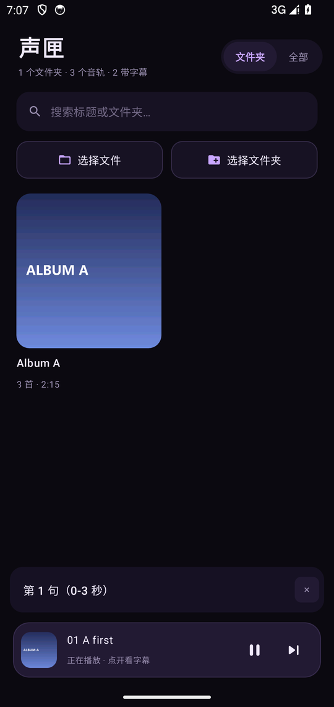

# 声匣 · koebox

一个专注「音频 + 同步字幕」的安卓本地播放器。

面向音声、有声书、Drama CD 这类「一段音频配一份台词」的内容：导入就是一个个专辑，
字幕跟着声音走，封面从作品目录里自动找。

> A local audio player for Android with synced LRC/SRT/VTT/ASS subtitles,
> folder-based album library, and automatic cover detection.

> 说明：这个项目仅仅是我个人自用的小工具，主要拿来听 ASMR。

<p align="center">
  
  
  
  
  
</p>

## 功能

- **按文件夹成专辑**：选一个目录 = 一个专辑，子目录原样保留，像文件管理器一样逐层浏览
- **字幕同步**：LRC / SRT / VTT / ASS 全部支持，当前句高亮、上下句淡显，点字幕跳转
- **字幕偏移**：±0.2s / ±1s 微调，设置记住
- **自动配对**：音频和同名字幕、同名封面自动配对；支持 `Track01.wav.vtt` 这种双扩展名
- **自动找封面**：同目录同名图 → `cover/folder/front/封面/ジャケット/表紙` → 插图目录 → 音频内嵌封面
- **附件归档**：图片、台本 txt、PDF 一并入库，图片可全屏看，文本可内置阅读，其余交给系统应用
- **批量换封面**：换封面时可以只改当前这首，也能一次替换整张专辑
- **悬浮字幕**：开关打开后，在资料库、专辑页也能看到底部浮动的当前字幕（可拖动、可关闭）
- **字幕不中断**：句与句之间的停顿里保持上一句，不会闪成空白
- **后台播放**：通知栏控制，锁屏继续放；每首记住上次播放位置
- **睡眠定时**：10 / 20 / 30 / 60 分钟自动暂停
- 单文件 1.8MB，无网络权限，所有数据留在本地

## 支持的格式

| 类型 | 格式 |
| --- | --- |
| 音频 | MP3、M4A/M4B、WAV、FLAC、AAC、OGG、OPUS、MP4（音轨）、WMA、APE、DSF、DFF、MKA、W64 |
| 字幕 | LRC、SRT、VTT、ASS/SSA、带时间轴的 TXT |
| 封面 | JPG、PNG、WEBP、BMP、HEIC + 音频内嵌封面 |

字幕编码自动识别 UTF-8 / UTF-16 / Shift_JIS。

## 安装

从 [Releases](https://github.com/wan3/koebox/releases) 下载 APK 安装。安装包是自签名的，系统提示「未知来源」时选允许即可。

要求 Android 7.0（API 24）及以上。

## 构建

```bash
# 需要 JDK 17、Android SDK（compileSdk 34）
export ANDROID_HOME=/path/to/android-sdk
./gradlew assembleRelease
```

产物在 `app/build/outputs/apk/release/app-release.apk`。

> 仓库里不含签名密钥。自行构建时请在 `app/build.gradle.kts` 里配置自己的 keystore，
> 否则 Release 包会用调试签名。

推 `v*` 标签时 GitHub Actions 会自动构建并把 APK 附到对应 Release
（见 `.github/workflows/build.yml`）。若仓库配置了 `KEYSTORE_BASE64`、`KEYSTORE_PASSWORD`、
`KEY_PASSWORD` 三个 secrets，产物会用正式签名；没配置则退回调试签名，仅供验证。

## 目录结构

```
app/src/main/java/com/koebox/app/
├── data/           数据层：模型、导入、字幕解析、ID3
├── playback/       Media3 播放服务
├── ui/             Compose 界面：库、专辑、播放页
└── MainActivity.kt
```

## 已知限制

- MP4 只播音频轨，不显示画面
- 只支持本地文件，不做在线流播
- 导入会把文件**复制**进应用私有目录，大文件（24bit WAV 专辑常有 1GB+）会占空间
- 卸载应用会一并删除已导入的副本

## English

**koebox** is a local audio player for Android built around synced subtitles — for audio dramas,
audiobooks, ASMR and any "one audio file, one script" content. No network permission, everything stays on device.

- **Folder-based albums** — pick a folder and it becomes one album; subfolders stay browsable like a file manager
- **Synced subtitles** — LRC / SRT / VTT / ASS with the current line highlighted, tap a line to seek, ±0.2s / ±1s offset
- **Automatic pairing** — audio pairs with same-named subtitles and covers, including double extensions such as `Track01.wav.vtt`
- **Cover detection** — same-name image → `cover/folder/front/jacket` → illustration folder → embedded artwork
- **Attachments** — images, scripts and PDFs are kept with the album; images open full screen, text is readable in-app
- **Floating subtitles** — optional subtitle bar on the library and album screens while playing
- **Subtitles never blink out** — a line stays on screen through pauses until the next one starts
- **Background playback** — notification controls, per-track resume, sleep timer

Requires Android 7.0 (API 24) or newer. Grab the APK from
[Releases](https://github.com/wan3/koebox/releases). MIT licensed.

## 免责声明

- 本应用仅提供本地音视频文件的播放功能，**不提供、不托管、不分发任何音视频内容**。
- 与任何音声制作社团、发行商、平台均无关联，未获其授权或背书。
- 用户导入的文件由用户自行获取，请确保来源合法；开发者不对导入内容及其使用方式承担责任。
- 本应用不包含也不提供任何 DRM 绕过、解密或内容抓取功能。
- 软件按 MIT 许可「按现状」提供，不对适用性或使用后果作任何担保。

## 许可证

MIT
